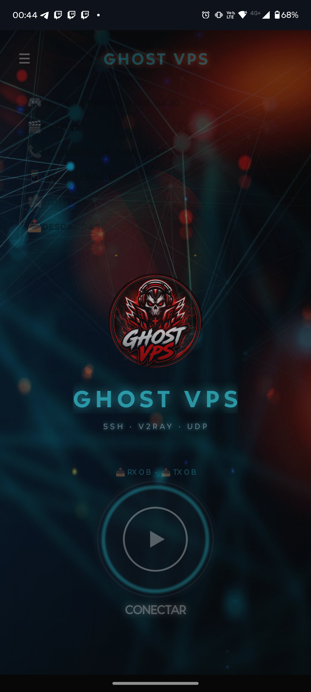
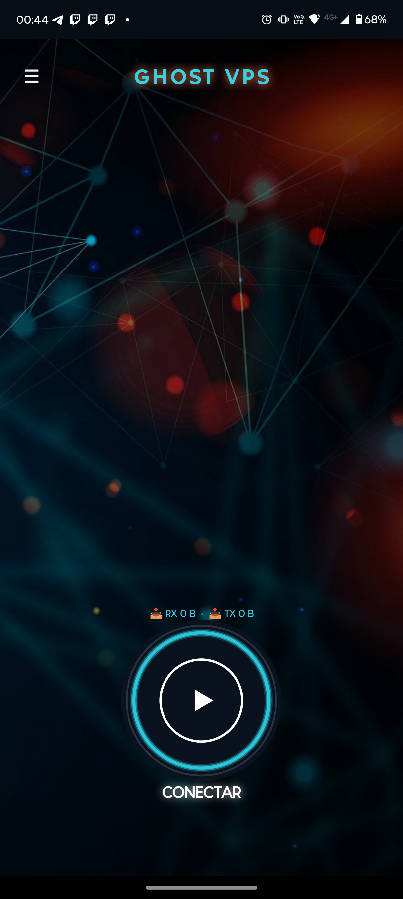
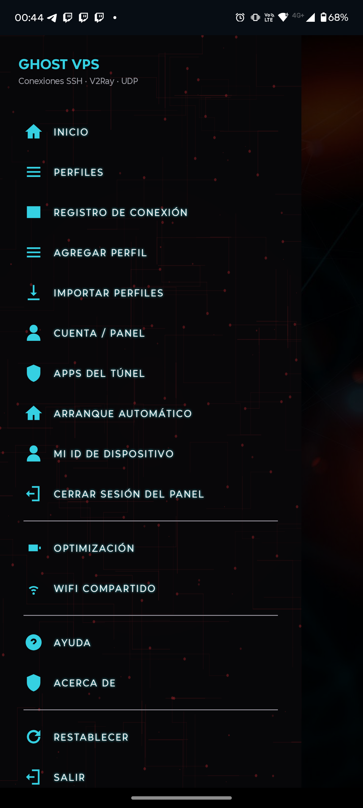
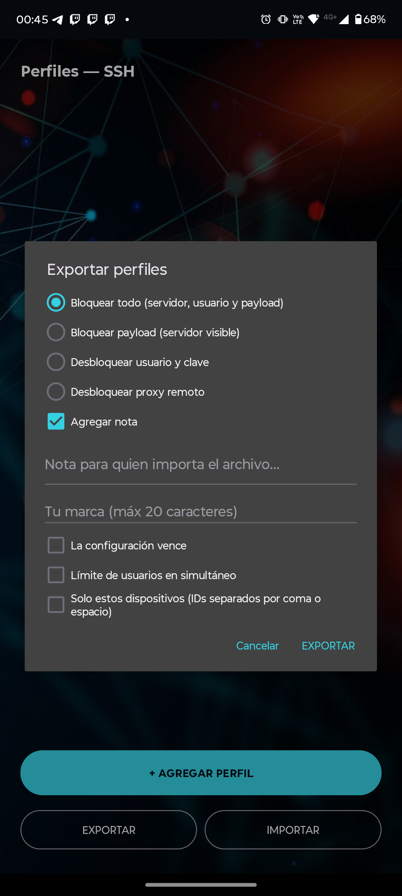

# 🛡️ GHOST VPS

**App Android de conexiones VPN estilo "HTTP Injector" — generada desde cero en Kotlin.**

Cliente VPN todo en uno con panel de administración propio, sistema de archivos de configuración cifrados y bloqueados, publicidad integrada e interfaz personalizada.

## 📱 Capturas

**Pantalla principal y conexión**

  
  

**Menú completo y sistema de archivos .ghv**

  
  

## ✨ Características principales

### Conexión
- **Motor SSH** con soporte de Payload, WebSocket y conexión directa
- **UDP Custom** con relay propio incluido (libtun2socks)
- Arquitectura preparada para OpenVPN y V2Ray
- Interfaz TUN nativa con `VpnService`
- Keepalive, reconexión automática por cambio de red y failover entre servidores

### Sistema de configuraciones (.ghv)
- Archivos de configuración **cifrados y bloqueables**
- **Atado a dispositivo**: cada archivo solo funciona en el celular autorizado (ID único por equipo)
- **Vencimiento configurable** en días (control de vigencia por cliente)
- Banner/nota personalizable con HTML por archivo
- Límite de usuarios en simultáneo (con panel)
- Edición y exportación desde la propia app

### Panel de administración (web)
- Gestión de servidores y usuarios con días de vigencia
- API pública para login automático en la app
- Claves hasheadas (PBKDF2 + salt), tokens con expiración, rate limiting
- Backup y restauración de la base desde la web
- Aviso global que se muestra en la app

### App
- Publicidad AdMob (interstitial al conectar)
- Reconexión automática, tile de ajustes rápidos, widget 1×1
- Selector de perfil, split tunneling (elegir qué apps pasan por el VPN)
- Registro de conexión con tráfico RX/TX en vivo

## 🛠️ Stack tecnológico

| Capa | Tecnología |
|---|---|
| App | Kotlin, VpnService, OkHttp, sshj, Gson |
| Panel | Python (FastAPI), SQLite |
| Build | Gradle (R8), firma propia |
| Ads | Google AdMob |
| Diseño | UI personalizada (tema oscuro, fondo propio) |

## 📄 Licencia

**Propietario — Todos los derechos reservados.**

Este repositorio es de **presentación** (showcase). El código fuente no es público.

© 2026 GHOST VPS
